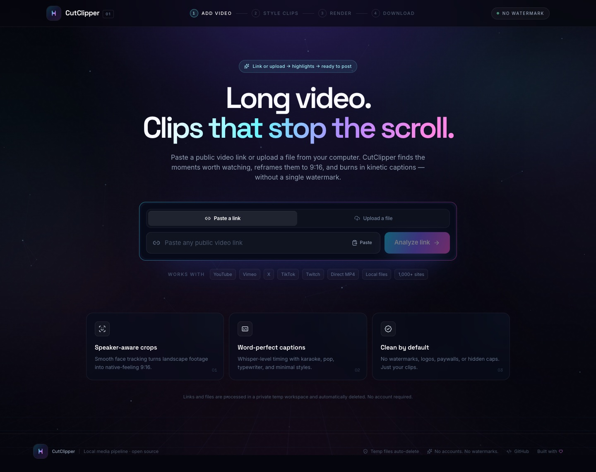
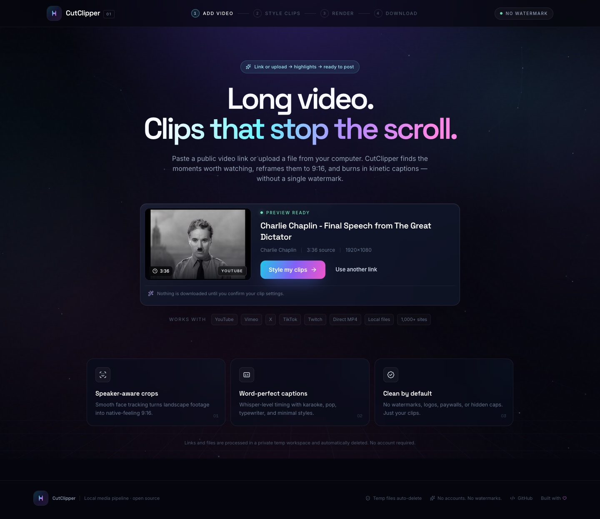
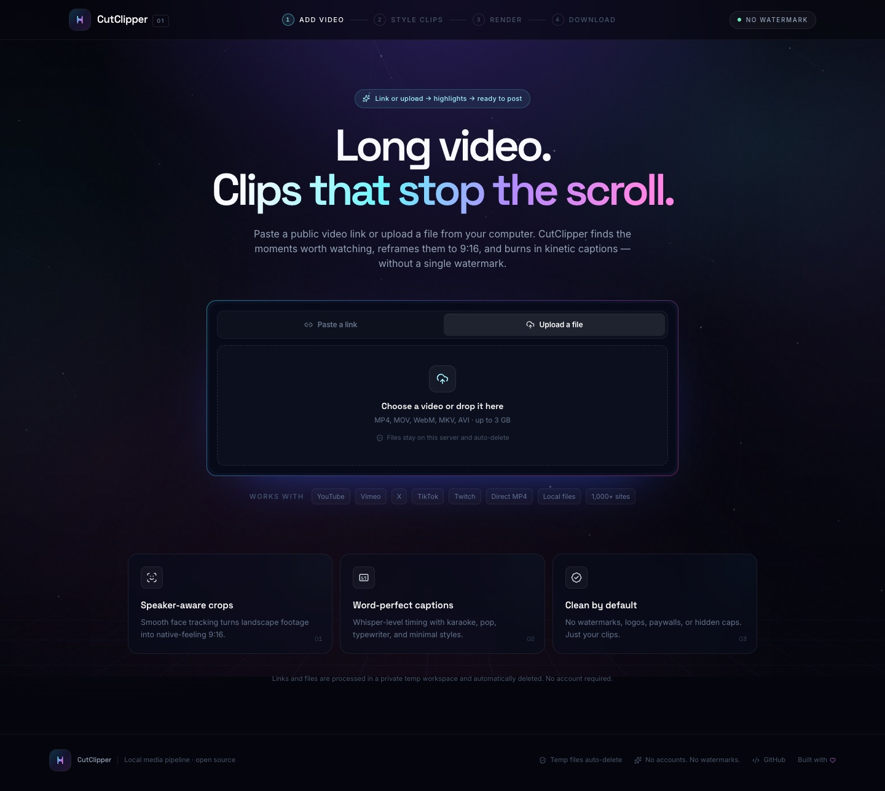
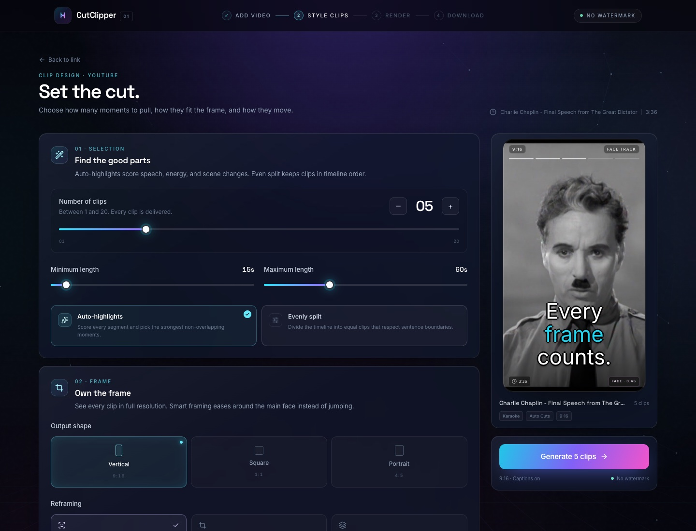
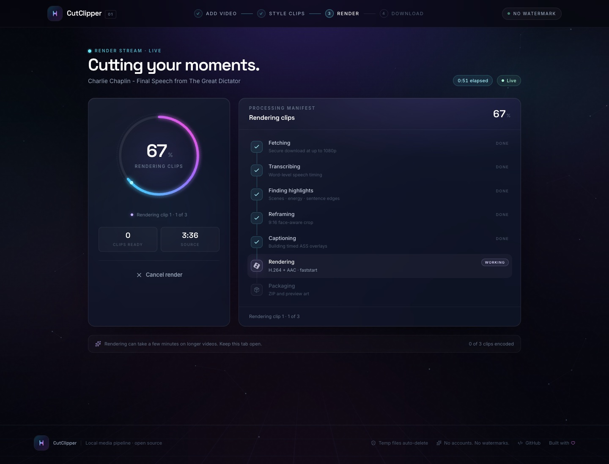
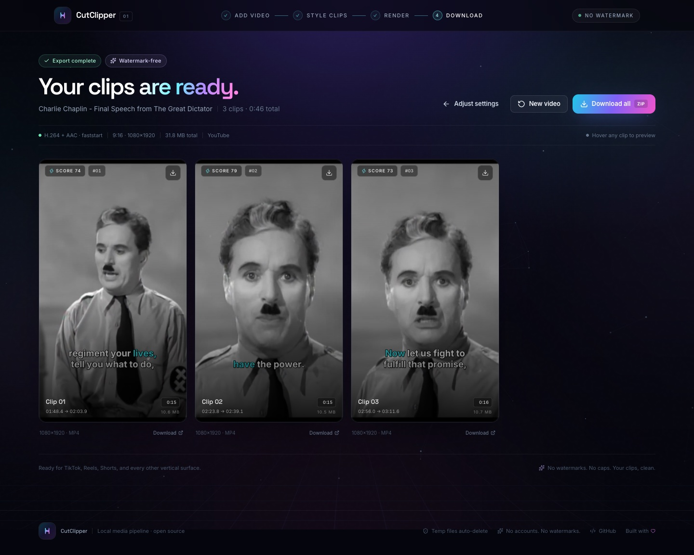
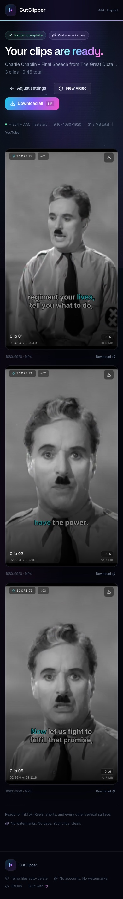

<div align="center">

# CutClipper

**Paste a link or drop a file. Get finished vertical clips.**  
CutClipper ingests a video from a public URL or a local upload, finds the moments worth keeping, reframes them to 9:16 with stabilized face tracking, burns in animated captions, and exports clean MP4s — no watermarks, no accounts, no usage caps.

[](https://github.com/shahil-kattel/cutclipper/actions/workflows/ci.yml)
[](LICENSE)
[](backend/)
[](frontend/)

[Features](#features) · [Screenshots](#screenshots) · [Quick start](#quick-start-docker) · [Local setup](#local-setup-without-docker) · [Configuration](#configuration) · [Troubleshooting](#troubleshooting)

</div>

---

## What it does

1. **Choose a source** — paste a public video URL (YouTube, Vimeo, X/Twitter, TikTok, Twitch VODs, direct `.mp4` links, and anything else yt-dlp supports) or upload a video from your computer.
2. **Preview the source** — title, artwork, duration, dimensions, and source before anything is processed.
3. **Choose a cut** — 1–20 clips, a 5–180 s length window, and either auto-highlight or even-split mode.
4. **Render** — smart 9:16 reframing, optional animated captions, optional transitions, H.264/AAC output.
5. **Download** — preview in the browser, download clips individually, or grab a ZIP of the whole set.

Link sources are fetched by the backend. Optional file uploads are stored only in CutClipper's local temp workspace. No browser extensions, peer-to-peer transfers, or cloud storage accounts are involved.

> **Tested end to end on a real YouTube source, a local upload, and the Caption studio.** A 3½-minute 1080p speech was downloaded, transcribed with Whisper, split into exactly 3 highlights, smart-cropped around the speaker, captioned with karaoke timing, encoded as 1080×1920 H.264/AAC, and verified for output dimensions, audio streams, Range playback, and ZIP delivery. An uploaded MP4 completed the same upload → preview → render → download path. The Caption studio was exercised with English and Nepali speech: transcription, line editing, live playback preview, Devanagari fonts (Mukta, Noto Sans Devanagari, Hind, Kalam), all eight presets, and final MP4 delivery. See [Screenshots](#screenshots).

## Features

### Link input, local uploads, and fetching
- Validates links, normalizes shorthand URLs, and blocks local/private network targets.
- `yt-dlp` download path, best quality up to 1080p, merged with FFmpeg.
- **Native direct-URL fallback** for `.mp4`/`.webm`/`.mov`/`.mkv` links that block generic webpage extraction.
- Clear errors for private, age-restricted, region-locked, removed, unsupported, live, and oversized videos.
- Retries with backoff for transient metadata/download failures.
- Automatic preview poster generation for direct video files without artwork.
- **Optional local uploads**: drag-and-drop or file picker with live progress, FFprobe validation, generated preview art, a configurable size ceiling, and the same TTL cleanup as link jobs.
- Uploaded files are streamed into an isolated temp folder under a random ID, then reused by the job workspace — never placed in a database.

### Selection that respects language
- Word-level timestamps from **faster-whisper**.
- Scene cuts from **PySceneDetect**.
- Audio-energy and speech-density analysis.
- Sentence-edge and silence-boundary snapping.
- **Auto-highlights** choose the top non-overlapping windows by a blended score of audio energy, speech density, sentence completeness, and scene alignment.
- Auto mode makes at most **6 clips** and automatically reduces the count when the source cannot fit the requested clips at the chosen minimum length.
- **Partial transcription** for long sources: when the requested outputs cover a small part of the timeline, only the planned highlight windows (energy-scored for auto, target slots for even) are sent to Whisper, and word timestamps are restored to absolute source time.
- **Evenly split** uses a dynamic program to stay near equal lengths while respecting the requested min/max.
- If a music-heavy video has no clean pauses, Evenly split transparently falls back to word/scene edges and says so in the results.
- Always returns exactly the requested clip count, or explains why the settings cannot fit.
- Videos with no speech use scenes + audio energy; no crashes.

### Reframing
- **Smart tracking** detects faces with OpenCV, follows the main face, applies temporal association, interpolation, robust smoothing, and path simplification before rendering.
- Crop movement is expressed as an interpolated FFmpeg crop path — no detector jitter.
- **Center crop** and **blur-background fit** fallbacks.
- 9:16 `1080×1920` by default, plus **1:1 `1080×1080`** and **4:5 `1080×1350`**.

### Captions and the Caption studio

- Word-timed ASS subtitles burned in via libass.
- **Caption studio** mode on the home page: upload a video, transcribe the whole thing, fix every line, preview it in a playable player, then download the captioned MP4. No highlight selection or reframing is applied in this mode.
- Nineteen animated presets: **Karaoke**, **Pop**, **Bounce**, **Highlight**, **Neon**, **Slide**, **Typewriter**, **Minimal**, **Fade Up**, **Zoom In**, **Stamp**, **Tilt**, **Spotlight**, **Underline**, **Pulse**, **Wiggle**, **Rainbow**, **Soft Blur**, and **Box**.
- Post-cut caption restyling: change font, style, colours, spacing, case, and position after a render and produce fresh MP4/ZIP downloads without re-cutting the source.
- Editable transcript: change text, start/end times, split at the playhead, merge lines, delete lines, or add new ones. Preview updates as you type.
- Playable in-browser preview with the selected preset, font, size, colours, position, outline, and shadow rendered live over the uploaded video.
- Fifty-one bundled font families with regular/bold/italic variants where available (Inter, Space Grotesk, Poppins, Bebas Neue, Mukta, Noto Sans Devanagari, Hind, Kalam, Rajdhani, Tiro Devanagari Hindi, and many more). Devanagari families shape conjuncts correctly in libass; the catalog is served from `/api/caption-fonts`.
- **Nepali speech recognition** with faster-whisper `ne`, a Nepali initial prompt, and Fast/Balanced/Best quality (`small`/`medium`/`large-v3`). Any other Whisper language can be selected too, with its own quality ladder (`base`/`small`/`medium`).
- Language is detected automatically by default; English, Nepali, and Hindi are one click away.
- Phone-safe margins, max two rendered lines, ASS injection sanitized.
- Bundled OFL fonts, including Mukta, Noto Sans Devanagari, Hind, and Kalam for Nepali captions.

### Transitions
- Fade, zoom, slide, and whip-pan.
- Applied at clip edges with an adjustable duration.
- Audio fades and de-clicking are applied in the same pass.
- All implemented with FFmpeg filters; no extra processing services.

### Export
- H.264 High profile, AAC 192 kbps, `yuv420p`, faststart, 30 fps, metadata stripped.
- 1080-wide social masters.
- Browser preview and per-clip download.
- Server-built ZIP archive for all clips.
- No watermark, logo, drawtext, or branded overlay anywhere in the pipeline.

### Jobs and UX
- FastAPI background queue with live progress via **SSE** (polling fallback in the client).
- Cancel a job at any stage; subprocesses are terminated as process groups.
- Per-job and per-upload temp directories with automatic TTL cleanup.
- Hardware encoder detection: VideoToolbox on macOS, NVENC when available, automatic CPU/x264 retry.
- SSE/polling connection indicator, toasts, skeletons, accessible controls, reduced-motion support, responsive layout.

## Screenshots

<div align="center">
  
</div>

<br />

<table>
  <tr>
    <td width="50%"><br /><sub><b>Preview a link before processing</b></sub></td>
    <td width="50%"><br /><sub><b>Or upload a local file</b></sub></td>
  </tr>
  <tr>
    <td width="50%"><br /><sub><b>Every control is live</b></sub></td>
    <td width="50%"><br /><sub><b>Live pipeline, stage by stage</b></sub></td>
  </tr>
</table>

<div align="center">
  
  <br /><sub><b>Hover-to-play results</b></sub>
  <br /><br />
  
  <br /><sub>Responsive from 320 px up</sub>
</div>

## Tech stack

| Layer | Tools |
|---|---|
| API | Python 3.11, FastAPI, Pydantic, Uvicorn, multipart uploads |
| Media | FFmpeg, ffprobe, yt-dlp, OpenCV, PySceneDetect |
| Speech | faster-whisper / CTranslate2 |
| Captions | ASS + libass |
| Frontend | React 19, Vite 8, TypeScript, Tailwind CSS 3, Framer Motion |
| Jobs | asyncio queue, SSE, thread/process isolation for CPU/OpenCV work |
| Deployment | Multi-stage Dockerfile, Docker Compose |

## Project structure

```text
cutclipper/
├── backend/
│   ├── app/
│   │   ├── api/routes.py          # REST + SSE endpoints
│   │   ├── core/                  # URL validation, typed errors
│   │   ├── pipeline/
│   │   │   ├── jobs.py            # queue, lifecycle, cleanup
│   │   │   ├── selection.py       # sentence-safe clip planner
│   │   │   ├── captions.py        # animated ASS generation
│   │   │   └── renderer.py        # crop paths + FFmpeg composition
│   │   ├── services/              # yt-dlp, uploads, Whisper, faces, scenes, audio
│   │   └── main.py                # FastAPI app + static frontend
│   ├── assets/fonts/              # bundled Inter TTF + license
│   ├── tests/                     # unit + E2E media tests
│   └── requirements.txt
├── frontend/
│   ├── src/components/            # link, settings, processing, results
│   ├── src/hooks/                 # SSE job stream, toasts
│   └── src/lib/                   # API client, formatting, defaults
├── docs/screenshots/
├── Dockerfile
├── docker-compose.yml
├── .env.example
└── LICENSE
```

## Quick start (Docker)

The fastest path on any Docker host:

```bash
git clone https://github.com/shahil-kattel/cutclipper.git
cd cutclipper
docker compose up --build
```

Open **http://localhost:8000**.

The multi-stage image builds the React bundle, installs FFmpeg and Python dependencies, bundles Node for yt-dlp's YouTube JavaScript challenges, runs as a non-root user, and persists temporary media + Whisper models in named volumes. The first Whisper run downloads the selected model.

Optional overrides:

```bash
CUTCLIPPER_WHISPER_MODEL=small docker compose up --build
CUTCLIPPER_JOB_TTL_SECONDS=3600 docker compose up
```

Docker runs on CPU by default. For an NVIDIA host, expose the GPU and add the NVIDIA runtime to Compose, then set `CUTCLIPPER_VIDEO_ENCODER=h264_nvenc` (the app falls back automatically if the encoder is unavailable).

## Local setup (without Docker)

### Prerequisites

- **Python 3.11+**
- **Node 22+**
- **FFmpeg with libass**, `ffprobe`, and an H.264 encoder

On macOS, Homebrew's regular `ffmpeg` formula does **not** include libass. Install the full build:

```bash
brew install python@3.11 node ffmpeg-full
```

CutClipper auto-detects `/opt/homebrew/opt/ffmpeg-full/bin/ffmpeg`. You can also point at it explicitly:

```bash
export CUTCLIPPER_FFMPEG_BINARY=/opt/homebrew/opt/ffmpeg-full/bin/ffmpeg
export CUTCLIPPER_FFPROBE_BINARY=/opt/homebrew/opt/ffmpeg-full/bin/ffprobe
```

On Debian/Ubuntu:

```bash
sudo apt update && sudo apt install -y ffmpeg python3.11 python3.11-venv \
  libgl1 libglib2.0-0 libsm6 libxext6 libxrender1
```

### Backend

```bash
cd cutclipper
cp .env.example .env
python3.11 -m venv backend/.venv
backend/.venv/bin/pip install -r backend/requirements-dev.txt
cd backend
.venv/bin/uvicorn app.main:app --reload --port 8000
```

API docs: **http://localhost:8000/api/docs**

The first transcription downloads the Whisper model (about 75 MB for `tiny`, 140 MB for `base`) into the Hugging Face cache.

### Frontend

In a second terminal:

```bash
cd cutclipper/frontend
npm install
npm run dev
```

Open **http://localhost:5173**. Vite proxies `/api` to the backend on port 8000.

### Single-process production build

```bash
cd cutclipper/frontend
npm run build
cd ../backend
.venv/bin/uvicorn app.main:app --host 0.0.0.0 --port 8000
```

Open **http://localhost:8000** — FastAPI serves the built frontend and the API from the same origin.

## Usage

1. Choose **Paste a link** or **Upload a file**. Link previews explain when a site requires cookies or sign-in; uploads show file-level progress and validation.
2. Check the preview card, then choose **Style my clips**.
3. Pick the clip count, minimum/maximum length, selection mode, aspect ratio, and reframing mode.
4. Toggle captions or transitions and tune their styles. The phone preview updates live.
5. Press **Generate**. Progress streams over SSE through fetching, transcribing, highlight selection, reframing, captioning, rendering, and packaging.
6. Hover a result card to autoplay it, download clips individually, or download the ZIP. Use **Adjust settings** to re-render or **New video** to start over.

Jobs are kept in `backend/data/jobs/<job-id>` and local uploads in `backend/data/uploads/<upload-id>` (or the Docker `/data` volume). Both are removed after **6 hours** by default. Completed jobs include a ZIP archive; if the prebuilt archive is missing, it is built on demand.

## Configuration

All settings use the `CUTCLIPPER_` prefix and can live in `.env` or the environment. See [`.env.example`](.env.example).

| Variable | Default | Description |
|---|---|---|
| `CUTCLIPPER_WHISPER_MODEL` | `base` | `tiny`, `base`, `small`, `medium`, `large-v3`, or local model path |
| `CUTCLIPPER_NEPALI_WHISPER_MODEL` | `medium` | Default model for Nepali speech; the Caption studio can override it per request with `fast`/`balanced`/`best` |
| `CUTCLIPPER_WHISPER_DEVICE` | `auto` | `auto`, `cpu`, `cuda` |
| `CUTCLIPPER_WHISPER_COMPUTE_TYPE` | `auto` | CTranslate2 compute type; `int8` is a good CPU choice |
| `CUTCLIPPER_VIDEO_ENCODER` | `auto` | `auto`, `h264_videotoolbox`, `h264_nvenc`, or `libx264` |
| `CUTCLIPPER_MAX_VIDEO_DURATION_SECONDS` | `7200` | Reject longer sources before download |
| `CUTCLIPPER_MAX_DOWNLOAD_BYTES` | `3000000000` | Download size ceiling |
| `CUTCLIPPER_MAX_UPLOAD_BYTES` | `3000000000` | Local upload size ceiling |
| `CUTCLIPPER_JOB_TTL_SECONDS` | `21600` | Temp job retention |
| `CUTCLIPPER_CLEANUP_INTERVAL_SECONDS` | `1800` | Cleanup sweep cadence |
| `CUTCLIPPER_MAX_CONCURRENT_JOBS` | `1` | Worker count |
| `CUTCLIPPER_YTDLP_COOKIES_FILE` | unset | Optional cookies file for authenticated public links |
| `CUTCLIPPER_FFMPEG_BINARY` | auto | Full path to a libass-capable FFmpeg |
| `CUTCLIPPER_FFPROBE_BINARY` | auto | Full path to ffprobe |

Frontend API base is controlled by `VITE_API_BASE` at build time (defaults to `/api`, served by the Vite proxy in dev and the FastAPI origin in production).

## API reference

| Method | Endpoint | Purpose |
|---|---|---|
| `GET` | `/api/health` | FFmpeg/libass/model status |
| `GET` | `/api/config` | Limits and default clip settings |
| `POST` | `/api/preview` | Validate a URL and return source metadata |
| `POST` | `/api/uploads` | Multipart local upload; validates, generates a poster, returns metadata |
| `GET` | `/api/uploads/{id}/thumbnail` | Preview poster for an uploaded file |
| `GET` | `/api/uploads/{id}/video` | Range-capable source stream for the playable caption preview |
| `GET` | `/api/caption-fonts` | Bundled caption font catalog with variants |
| `GET` | `/api/caption-fonts/{filename}` | Serves a bundled font for the in-browser preview |
| `POST` | `/api/captions/transcribe` | Transcribe an upload for the Caption studio; returns editable segments + words, with a per-language/quality cache |
| `POST` | `/api/jobs` | Create a job from `{url}` or `{upload_id}` plus settings. `mode: "captions"` + `segments` + `language` renders a full captioned video |
| `POST` | `/api/jobs/{id}/restyle` | Re-render a finished job's clips or captioned video with new caption styling |
| `GET` | `/api/jobs/{id}` | Current job snapshot |
| `GET` | `/api/jobs/{id}/events` | SSE progress stream |
| `POST` | `/api/jobs/{id}/cancel` | Cancel a queued/running job |
| `GET` | `/api/jobs/{id}/clips/{clip}/video` | Inline MP4 with Range support |
| `GET` | `/api/jobs/{id}/clips/{clip}/download` | MP4 attachment |
| `GET` | `/api/jobs/{id}/clips/{clip}/thumbnail` | JPEG poster |
| `GET` | `/api/jobs/{id}/download.zip` | All clips as ZIP |

Interactive OpenAPI docs: `/api/docs`.

## Testing and quality

```bash
cd backend
.venv/bin/pytest -q                    # URL, selection, caption, face path, and upload tests
.venv/bin/ruff check app tests
.venv/bin/black --check app tests

cd ../frontend
npm run lint
npm run typecheck
npm run build
```

The full media E2E test uses the committed sample `backend/tests/assets/sample-speech.mp4` (real synthesized speech) and downloads the tiny Whisper model on first run:

```bash
cd backend
CUTCLIPPER_E2E=1 .venv/bin/pytest -q -m e2e
```

The test exercises probe → audio extraction → faster-whisper word timestamps → energy analysis → selection → 1080×1920 rendering → H.264/AAC verification → caption generation. Upload storage, thumbnail generation, cleanup, and validation are covered by focused upload-store tests.

Additional manual verification performed on a real 1080p YouTube source:
- Source download and metadata extraction.
- Smart face tracking around the speaker.
- Exactly 3 non-overlapping clips with karaoke captions.
- Output streams verified at 1080×1920, H.264 `yuv420p`, AAC.
- HTTP Range preview playback (`206 Partial Content`).
- ZIP archive download.
- Direct-URL `.mp4` fallback, no-speech fallback, a silent video with no audio stream, 1:1/4:5 export, and all four transition styles.
- Local upload → 2-clip job → SSE → 1080×1920 output, plus upload thumbnails, missing-file validation, and oversized-request rejection.

## Hardware acceleration

- **macOS:** `h264_videotoolbox` is preferred when available.
- **NVIDIA:** `h264_nvenc` is used when the encoder and driver are visible.
- **Everything else:** `libx264`.
- If a hardware encode fails mid-job, that clip is automatically retried with `libx264` and the result notes the fallback.

Caption rendering, OpenCV face detection, and scene detection run on CPU. FFmpeg is always software-decoded for deterministic filter behavior.

## Isolation and cleanup

- OpenCV/PySceneDetect run in isolated worker subprocesses so their bundled FFmpeg libraries do not collide with PyAV in the API process.
- FFmpeg and yt-dlp are executed as asyncio subprocesses with process-group cancellation.
- Jobs execute in a single asyncio worker by default; CPU-heavy work yields to the event loop.
- Private/local URL targets, non-standard ports, credentials in URLs, and non-HTTP schemes are rejected.
- Videos and uploads are only kept in temp folders and are deleted by the cleanup loop. No user media is stored in a database.
- Upload size is checked from `Content-Length` before multipart parsing, then enforced again while streaming to disk. If you expose CutClipper directly to the internet, put a reverse proxy with a body-size limit in front and add authentication.
- URL validation blocks private/local targets before a fetch. Public deployments should also enforce outbound egress rules (and should not expose the renderer to untrusted users), because downstream media tools can follow redirects after the initial validation.

## Troubleshooting

### “Captions require an FFmpeg build with libass”
Your FFmpeg build lacks libass. Install `ffmpeg-full` on macOS or a distro FFmpeg with libass support. Set `CUTCLIPPER_FFMPEG_BINARY` and `CUTCLIPPER_FFPROBE_BINARY` to the matching binaries and restart.

### YouTube says the video requires sign-in
Some videos need cookies or are age-gated. Export a Netscape-format cookies file from a browser session you control and set `CUTCLIPPER_YTDLP_COOKIES_FILE=/path/to/cookies.txt`. Public videos normally work without cookies. Keep yt-dlp current with `pip install -U yt-dlp`.

### A direct `.mp4` link fails
CutClipper first tries a native HTTP probe/download and falls back to yt-dlp. If the host requires signed cookies, a special User-Agent, or blocks this server's region, download the file and use **Upload a file**, or host it somewhere public.

### Too many clips / length issue
The clip count multiplied by the minimum length cannot exceed the source duration. The Settings screen shows the maximum feasible count. Even split also requires the average length to fit under your maximum.

### Long videos are slow
Whisper and rendering are compute-bound. Options:
- Reduce the video/whisper model size (`tiny` or `base`).
- Set `CUTCLIPPER_WHISPER_COMPUTE_TYPE=int8` on CPU.
- Use a machine with CUDA and expose the GPU.
- Run on a shorter source. The default hard ceiling is 2 hours; lower it with `CUTCLIPPER_MAX_VIDEO_DURATION_SECONDS`.

### Job disappears after restart
Jobs are held in memory and intentionally ephemeral. Temp files remain until the cleanup TTL. Recreate the job from the same link. This is a local-first single-process design; a durable queue can be swapped in later.

### Captions are off-screen on a special phone UI
Use the Bottom position with the default safe margins, or pick a different position. Outlines/shadows are adjustable.

### CORS in a split deployment
Set `CUTCLIPPER_CORS_ORIGINS='["https://your-frontend.example"]'` (JSON array) and build the frontend with `VITE_API_BASE=https://api.example.com/api`.

## Design notes and limitations

- **No internal jump-cut assembly.** Each highlight is a contiguous source range. Transitions apply at each clip's entrance and exit. This avoids awkward franken-clips and keeps every cut sentence-safe.
- **One machine.** The queue is an in-process asyncio queue; running multiple replicas would require a shared queue and shared storage.
- **Local uploads are spooled by FastAPI before validation.** Starlette writes multipart file parts to a spooled temp file; the app enforces a size ceiling from `Content-Length` and again while copying, but untrusted internet deployments should enforce body limits at the proxy and add authentication.
- **No authenticated multi-tenancy.** Temp upload/job IDs are unguessable, but anyone with network access to the API can create jobs or uploads. Run it on a trusted network or put an auth proxy in front.
- **Single subtitle track per clip.** Captions are localized to the selected clip and use the target output's safe area.
- **Face tracking is person-focused.** The largest stable face is treated as the subject. For group shots or no faces, center crop or blur-fit are better choices.
- **No content bypassing.** CutClipper only downloads public URLs you can access; it does not bypass DRM, paywalls, or private-video restrictions.
- **Respect creators.** Only download and republish videos you have the rights to use. The MIT license covers the software, not the media you process with it.

## License

MIT — see [`LICENSE`](LICENSE). Bundled Inter font files are licensed under the SIL Open Font License; their license is included in [`backend/assets/fonts/Inter-LICENSE.txt`](backend/assets/fonts/Inter-LICENSE.txt).

Built with [yt-dlp](https://github.com/yt-dlp/yt-dlp), [FFmpeg](https://ffmpeg.org/), [faster-whisper](https://github.com/SYSTRAN/faster-whisper), [PySceneDetect](https://www.scenedetect.com/), [OpenCV](https://opencv.org/), [FastAPI](https://fastapi.tiangolo.com/), and [React](https://react.dev/).
